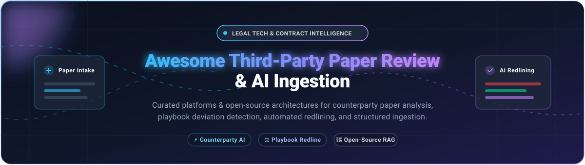
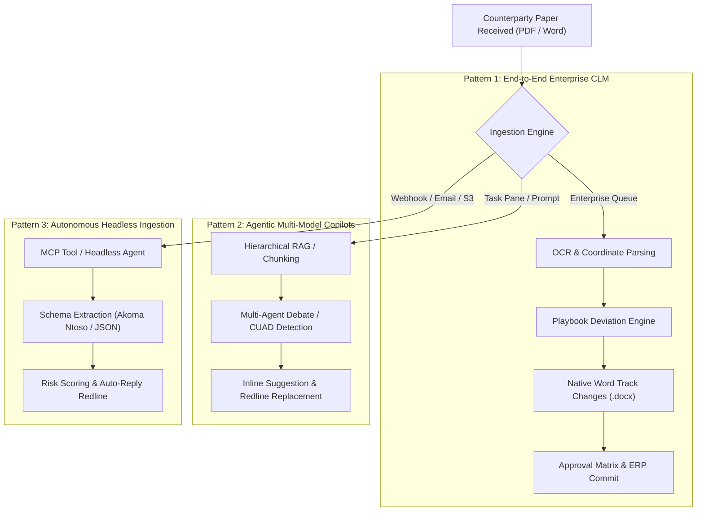

# Awesome Third-Party Paper Review & AI Ingestion

  <b>A curated catalog of enterprise SaaS solutions and open-source tools for automated third-party paper review, counterparty contract analysis, AI ingestion, playbook deviation detection, and Word-integrated redlining.</b>

[Sector Overview](#-sector-overview--market-dynamics) • [SaaS Platforms](#-saas--hosted-platforms) • [Open-Source Solutions](#-open-source-software) • [Comparison Matrix](#-comparison-at-a-glance) • [Contributing](#-contributing)

---

## 📈 Sector Overview & Market Dynamics

The contract intelligence and AI-powered contract review sector is estimated at **$1.7B to $3.05B** (with the broader Contract Lifecycle Management / CLM software market projected to reach **$3.68B** by 2026 at a **11.6%–16.8% CAGR**). The sector remains **moderately to highly fragmented**, characterized by legacy enterprise CLM platforms (Icertis, DocuSign, Workday Evisort), emerging generative-AI legal copilots (Spellbook, Luminance, Robin AI), and specialized open-source agentic frameworks contending with low technical barriers to baseline LLM text extraction but high enterprise moats in defensible playbook execution and Microsoft Word redlining workflows.

---

## 📋 Table of Contents

- [Sector Overview & Market Dynamics](#-sector-overview--market-dynamics)
- [SaaS / Hosted Platforms](#-saas--hosted-platforms)
- [Open-Source Software](#-open-source-software)
- [Comparison at a Glance](#-comparison-at-a-glance)
- [Architecture & Workflow Patterns](#-architecture--workflow-patterns)
- [Contributing](#-contributing)
- [License](#-license)

---

## 🟦 SaaS / Hosted Platforms

Enterprise cloud-hosted Third-Party Paper Review and AI Ingestion platforms. Sorted descending by company scale (valuation or revenue/acquisition value).

| Platform | Company Scale (Valuation / Revenue) | Starting Pricing (Specific Tier) | Free Tier / Trial Limit | Review & Redline Capabilities | Best For |
|:---|:---|:---|:---|:---|:---|
| **[Icertis Vera Engage](https://www.icertis.com)** | **$5.0B Valuation** (~$350M ARR) | **$100,000/year** (Enterprise Base Subscription, ~**$150–$350/user/mo** equivalent; excludes $100K+ implementation) | **No Free Tier / No Self-Serve Trial** (Enterprise demo & private sales consultation only) | Agent-driven counterparty contract analysis; scores deviation risks; generates Word track-changes redlines against company playbooks. | Global enterprises requiring CLM-integrated risk scoring and automated Word redlines. |
| **[Ironclad Contract Review Agent](https://ironcladapp.com)** | **$3.2B Valuation** (~$200M+ ARR) | **$500/month** (Sold as annual commit starting at **~$30,000/year**; plus $10K+ implementation fee) | **14-Day Free Trial** (Full sandbox environment with limited sample contract seats) | Redlines counterparty contracts against custom playbooks and precedent repositories in 50+ languages inside Word. | In-house legal teams wanting playbook-grounded redlining with historical CLM precedent context. |
| **[Casetext CoCounsel](https://casetext.com)** *(Thomson Reuters)* | **$650M Acquisition Value** (Thomson Reuters: ~$80B Cap) | **$340.85/user/month** (*CoCounsel Essentials* document analysis tier on annual contract) | **No Open Free Tier / 7–14 Day Sales Pilot** (Available via sales demo / structured POC) | AI legal assistant specializing in deep clause extraction, multi-document cross-referencing, and risk summarization. | Law firms and legal teams seeking defensible third-party paper verification and research. |
| **[Luminance](https://www.luminance.com)** | **$400M Valuation** (~$30M ARR, $165M raised) | **$43,000/year** (Mid-market annual enterprise license; custom volume packaging) | **No Free Tier / Sales-Guided Pilot** (Custom 14-to-30-day proof-of-concept on client documents) | Cross-document reasoning engine (*Deep Insights*) that identifies conflicting provisions across amendments and parent agreements. | Enterprises requiring portfolio-level reconciliation across complex contract suites. |
| **[Spellbook](https://www.spellbook.legal)** | **$350M Valuation** (Tripled ARR, $80M equity raised) | **$90/user/month** (Entry seat tier billed annually; advanced agent seats at $250+/user/mo) | **7-Day Free Trial** (Full Microsoft Word add-in features, up to 10 document reviews) | Transactional copilot embedded in Microsoft Word; suggests alternative clauses, highlights aggressive terms, and executes tracked redlines. | Transactional lawyers and boutique legal teams wanting instant, high-speed Word redlining. |
| **[Evisort](https://www.evisort.com)** *(Workday)* | **$311M Acquisition Value** (Acquired by Workday Oct 2024) | **$30,000/year** (Workday CLM enterprise package; volume & seat dependent) | **No Free Tier / No Trial** (Enterprise demo and customized Workday tenant POC only) | Automated OCR ingestion of counterparty PDFs; metadata extraction; centralized redline version management. | Workday enterprise customers consolidating third-party paper intake into unified procurement. |
| **[Robin AI](https://www.robinai.com)** | **~$150M Peak Valuation** (~£8M revenue run-rate) | **$120/user/month** (*Pro Tier*; custom Enterprise pricing for bespoke playbooks) | **Free Forever Tier**: 1 user, max 10 AI messages/day, basic clause search (Pro trial 14 days) | Conversational assistant with clickable citations back to the exact contract clause; side-by-side markup suggestions. | Teams prioritizing citation-verified Q&A and transparent clause attribution. |
| **[Kira Systems](https://kirasystems.com)** *(Litera)* | **Undisclosed Litera Division** (Parent Litera PE backed by Hg) | **$5,000/year** (Starting specialized tier; scaled law firm licenses $30K–$60K+/year) | **No Public Free Tier / 30-Day POC** (Law firm sample document evaluation via sales pilot) | Hybrid AI combining lawyer-trained models with generative extraction; multi-clause tabular grid for high-volume paper. | Legal due diligence teams requiring audit-defensible, human-verified clause extraction. |
| **[ThoughtRiver](https://www.thoughtriver.com)** | **$18.8M Total Funding** (~$5.3M Annual Revenue) | **£15,000/year** (~$19,500/yr, *Professional Tier* up to 50 contracts/mo, unlimited seats) | **28-Day Free Trial** (Word add-in trial with 5 full automated contract risk assessments) | Pre-signature triage engine scoring counterparty contracts against risk thresholds and company playbooks. | Corporate procurement and legal departments seeking fast first-pass contract risk scoring. |

---

## 🟩 Open-Source Software

Self-hosted, developer-friendly open-source frameworks, MCP servers, and LLM skills for third-party paper ingestion, automated contract review, and redlining. Sorted descending by GitHub star count.

| Project | Stars | License | Primary Tech Stack | Third-Party Paper Focus | Redlining Engine | Key Highlights & Architecture |
|:---|:---:|:---:|:---|:---:|:---:|:---|
| **[ai-legal-claude](https://github.com/zubair-trabzada/ai-legal-claude)** |  | MIT / Open | Claude Code / Agentic Prompts / PDF | ✅ Full Review | ✅ Negotiation Strategy | 14 legal skills and 5 parallel agent workflows; automated contract intake, risk analysis, compliance audits, and client-ready PDF summaries. |
| **[claude-legal-skill](https://github.com/evolsb/claude-legal-skill)** |  | MIT | Python / Claude / CUAD / Cursor | ✅ Ingestion | ✅ Tracked Redlines | Benchmarked against Atticus CUAD dataset; lawyer-ready contract redlines, playbook risk detection, and compatibility with 26+ IDE agent tools. |
| **[lavern](https://github.com/AnttiHero/lavern)** |  | Apache-2.0 | Python / Multi-Agent / RAG | ✅ Deep Review | ✅ Clause Markup | Agentic legal architecture with 67 specialist agents reviewing counterparty paper through evidence-backed debate and a 10-pass verification loop. |
| **[contract-review-pro](https://github.com/CSlawyer1985/contract-review-pro)** |  | Open Source | Python / LLM Prompts / Legal Rules | ✅ Third-Party Docs | ✅ Risk Revision | Professional methodology-based contract examination skill engineered for structural compliance, liability caps, and indemnity auditing. |
| **[xiaodingfeng/contract-review](https://github.com/xiaodingfeng/contract-review)** |  | MIT | Python / Vue / OnlyOffice / RAG | ✅ Counterparty Paper | ✅ Online Document Diff | Full-stack Web application featuring OnlyOffice integration, AI pre-analysis, custom review checklist configuration, and judicial precedent retrieval. |
| **[ContractGuard](https://github.com/he-yufeng/ContractGuard)** |  | MIT | Python / OCR / LangChain | ✅ Fine Print Intake | ⚠️ Risk Warnings | Autonomous consumer & SME contract agent; ingests PDF/scans, detects hidden liabilities, unfair clauses, and auto-generates negotiation levers. |
| **[WorkWit-AI-Agent](https://github.com/crane-in-clear-sky/WorkWit-AI-Agent)** |  | MIT | Docker / Python / MCP / Vue | ✅ Enterprise Ingest | ✅ Auto Deviation | Self-hosted enterprise AI agent platform for office automation; built-in contract intake & review skills, 40+ MCP connectors, and multi-tenant RBAC. |
| **[ally-legal-assistant](https://github.com/Azure-Samples/ally-legal-assistant)** |  | MIT-0 | TypeScript / C# / Word Add-in / Azure AI | ✅ Counterparty Paper | ✅ Auto-Markup (Word) | Microsoft Word task-pane plugin built on Azure OpenAI; conducts real-time contract Q&A, clause extraction, and native inline markup insertion. |
| **[Vaquill ms-word-addin](https://github.com/Vaquill-AI/ms-word-addin)** |  | Apache-2.0 | TypeScript / Office.js / React | ✅ Counterparty Review | ✅ Word Redlining | Open-source Microsoft Word Add-in for transactional contract review, custom playbook execution, legal research, and automated clause replacement. |
| **[legal-redline-tools](https://github.com/evolsb/legal-redline-tools)** |  | MIT | Python / `python-docx` / PyMuPDF | ✅ Third-Party Docx | ✅ Tracked Changes & PDF Diff | Generates lawyer-grade `.docx` files with true Microsoft Word Track Changes enabled, alongside side-by-side redline diff PDFs. |
| **[agentmail-examples](https://github.com/agentmail-to/agentmail-examples)** |  | MIT | Python / Docker / OpenAI | ✅ Email Attachment Intake | ✅ Email Redlines | Lightweight automated email-driven contract reviewer; receives counterparty attachments via email, evaluates risky provisions against JSON rules, and replies with redlines. |
| **[hermes-legal](https://github.com/Lethe044/hermes-legal)** |  | MIT | Python / Groq / Ollama / Streamlit | ✅ Offline / Cloud | ✅ Sign/Reject Verdict | Multi-provider contract analysis tool; scores indemnity/termination risks, proposes redline revisions, and runs 100% locally with zero data leakage. |
| **[LexReviewer](https://github.com/LexStack-AI/LexReviewer)** |  | Apache-2.0 | Python / FastAPI / RAG / React | ✅ PDF Ingestion | ⚠️ Grounded Citations | Ingests complex legal PDFs, constructs hierarchical vector indexes, and facilitates grounded conversation with visual bounding-box citations. |
| **[Codify Core](https://github.com/CodifyIQ/codifyiq-core-components)** |  | Apache-2.0 | Python / PostgreSQL / Docker | ✅ Legal XML / PDF | ❌ Extraction Only | Ingests unstructured legal documents into standardized Akoma Ntoso 3.0 XML with precise section, article, and clause coordinate anchoring. |
| **[contract-review-ai-mcp](https://github.com/CSOAI-ORG/contract-review-ai-mcp)** |  | MIT | Python / FastMCP | ✅ Tool Exposure | ⚠️ Compliance Checks | Model Context Protocol (MCP) server exposing contract risk assessment, EU AI Act compliance checks, and clause evaluation tools to LLM agents. |
| **[draftLegal](https://github.com/judcouns-oss/draftlegal)** |  | AGPL-3.0 | TypeScript / Python / Docker | ✅ Full Counterparty Paper | ✅ Multi-Tier Redline | Self-hosted, AI-native CLM platform designed as an open-source alternative to Ironclad + Harvey; supports conservative/aggressive redlines and BYO LLM keys. |
| **[Legalyze](https://github.com/whizzel/legalyze)** |  | Open Source | Python / Hierarchical RAG | ✅ Statutory Ingestion | ❌ RAG Intelligence | Structure-aware legal intelligence framework utilizing Structure-Aware Hierarchical Indexing (SAHI) and dual-stream retrieval for dense legal corpora. |

---

## 📊 Comparison at a Glance

| Solution | Deployment | License | Third-Party Paper Ingestion | Tracked Word Redlines | Company Scale / Repo Stars | Starting Cost Tier | Free Evaluation Tier |
|:---|:---|:---|:---:|:---:|:---|:---|:---|
| **Icertis Vera** | SaaS | Proprietary | ✅ | ✅ | $5.0B Valuation | $100K/year | Contact Sales |
| **Ironclad Agent** | SaaS | Proprietary | ✅ | ✅ | $3.2B Valuation | $30K/year ($500/mo) | 14-Day Sandbox |
| **Casetext CoCounsel** | SaaS | Proprietary | ✅ | ❌ | $650M Acq. | $340.85/user/mo | Sales Demo |
| **Luminance** | SaaS | Proprietary | ✅ | (Analysis) | $400M Valuation | $43K/year | Sales POC |
| **Spellbook** | SaaS / Word | Proprietary | ✅ | ✅ | $350M Valuation | $90/user/mo | 7-Day Free Trial |
| **Evisort (Workday)**| SaaS | Proprietary | ✅ | (Version Diff)| $311M Acq. | $30K/year | Sales Demo |
| **Robin AI** | SaaS / Word | Proprietary | ✅ | (Drafting) | $150M Valuation | $120/user/mo | Free Forever Tier |
| **Kira (Litera)** | SaaS | Proprietary | ✅ | (Extraction) | Litera Group | $5K–$30K/year | 30-Day Firm POC |
| **ThoughtRiver** | SaaS / Word | Proprietary | ✅ | (Analysis) | $18.8M Funding | £15K/year | 28-Day Free Trial |
| **ai-legal-claude** | Self-Hosted | MIT / Open | ✅ | ✅ | 1,800+ ⭐ | $0 (Open Source) | Free Forever |
| **claude-legal-skill**| Self-Hosted | MIT | ✅ | ✅ | 500+ ⭐ | $0 (Open Source) | Free Forever |
| **lavern** | Self-Hosted | Apache-2.0 | ✅ | ✅ | 300+ ⭐ | $0 (Open Source) | Free Forever |
| **contract-review-pro**| Self-Hosted| Open Source | ✅ | ✅ | 290+ ⭐ | $0 (Open Source) | Free Forever |
| **xiaodingfeng/review**| Self-Hosted | MIT | ✅ | ✅ | 160+ ⭐ | $0 (Open Source) | Free Forever |
| **ContractGuard** | Self-Hosted | MIT | ✅ | ⚠️ | 150+ ⭐ | $0 (Open Source) | Free Forever |
| **WorkWit-AI-Agent** | Self-Hosted | MIT | ✅ | ✅ | 100+ ⭐ | $0 (Open Source) | Free Forever |
| **ally-assistant** | Self-Hosted | MIT-0 | ✅ | ✅ | 80+ ⭐ | $0 (Open Source) | Free Forever |
| **Vaquill add-in** | Self-Hosted | Apache-2.0 | ✅ | ✅ | 75+ ⭐ | $0 (Open Source) | Free Forever |
| **legal-redline-tools**| Self-Hosted| MIT | ✅ | ✅ | 60+ ⭐ | $0 (Open Source) | Free Forever |
| **agentmail-examples**| Self-Hosted | MIT | ✅ | ✅ | 40+ ⭐ | $0 (Open Source) | Free Forever |
| **hermes-legal** | Self-Hosted | MIT | ✅ | ✅ | 25+ ⭐ | $0 (Open Source) | Free Forever |
| **LexReviewer** | Self-Hosted | Apache-2.0 | ✅ | ⚠️ | 20+ ⭐ | $0 (Open Source) | Free Forever |
| **Codify Core** | Self-Hosted | Apache-2.0 | ✅ | ❌ | 3+ ⭐ | $0 (Open Source) | Free Forever |
| **review-ai-mcp** | Self-Hosted | MIT | ✅ | ⚠️ | 2+ ⭐ | $0 (Open Source) | Free Forever |
| **draftLegal** | Self-Hosted | AGPL-3.0 | ✅ | ✅ | Early-Stage ⭐ | $0 (Open Source) | Free Forever |
| **Legalyze** | Self-Hosted | Open Source | ✅ | ❌ | Academic ⭐ | $0 (Open Source) | Free Forever |

---

## 🏗 Architecture & Workflow Patterns

When evaluating solutions for third-party paper review and AI ingestion, systems typically follow three architectural patterns:

1. **Enterprise CLM Ingestion (Icertis, Ironclad, Workday Evisort):** Emphasizes governance, historical precedent repositories, role-based access, and enterprise ERP integration.
2. **Interactive Transactional Copilots (Spellbook, Vaquill, Ally):** Embeds directly inside Microsoft Word via Office.js, enabling interactive inline negotiation and instant playbook markups.
3. **Headless & Microservice Ingestion (draftLegal, legal-redline-tools, MCP):** Decoupled pipelines that ingest PDFs via email or API, parse structure, score risks with local/cloud LLMs, and output standardized `.docx` track changes or Akoma Ntoso 3.0 XML.

---

## 🤝 Contributing

Contributions are welcome! If you maintain or use an open-source contract analysis tool or know of a cutting-edge platform:

1. Fork this repository.
2. Create your feature branch (`git checkout -b feature/add-new-tool`).
3. Add the project with GitHub star count, license, tech stack, and primary differentiators.
4. Open a Pull Request with a clear description of why the tool is valuable for third-party paper ingestion.

---

## 📄 License

This repository and compilation are dedicated to the public domain under the [Creative Commons Zero v1.0 Universal](LICENSE) (CC0 1.0). Individual software projects retain their respective open-source or proprietary licenses.
